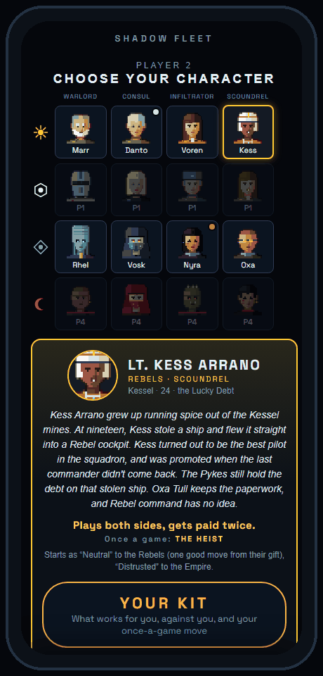

# Shadow Fleet

**A galaxy-conquest board game where the board is 3D-printed, the table is a glowing round screen, and every player's secrets live on their own phone.**

2–4 players · 6, 8 or 10 rounds · ages 12+ · an unofficial Star Wars fan project

## What it is

You print the map, drop a small round ESP32 screen into its center, and everyone joins the game by scanning a QR code with their phone. No app to install.

- **Your phone is your hand of cards.** Credits, favor with each faction, secret debts, jobs and gambits stay on your screen.
- **The table runs the galaxy.** It deals the worlds, rolls the dice, keeps the clock and shows the big moments to the whole table.
- **Three ways to take a world:** FIGHT with your fleets, NEGOTIATE by answering its faction's questions, or BRIBE it.
- **Favor matters.** Four factions remember everything you do. Climb high enough and you become a faction's Champion, and can declare an Era that changes the rules for everyone.
- **Sixteen commanders, four classes,** each with a once-a-game power.

Ships move on the physical map; the software handles what a board can't: hidden information, the economy, reputation, dice and scoring.

## What you need

| Part | Notes |
|---|---|
| Waveshare **ESP32-S3-Touch-AMOLED-1.43** | The table screen. 16 MB flash, 8 MB PSRAM |
| USB-C cable + a USB power supply | Powers the table during play |
| The printed map | 1-piece or 3-piece version, files on MakerWorld |
| M2 self-tapping screws (×3), 8 mm | Hold the back plate under the screen (6 to 10 mm works) |
| 2–4 phones | Any recent iPhone or Android with a browser |

What to print, colours and step-by-step assembly: [docs/assembly_guide.md](docs/assembly_guide.md).

## Install the firmware

**The easy way: the web installer.** Open the installer page in Chrome or Edge on a computer, plug the screen in by USB, click **Install**: **https://anakin130013.github.io/ShadowFleetGame/**

**From source (Arduino IDE)**, if the web installer won't work on your computer:
1. Install **Arduino IDE 2**. In Boards Manager, install **esp32 by Espressif Systems 3.3.10**. In Library Manager, install **lvgl 9.5.0**.
2. Copy `arduino/lv_conf.h` from this repo into your Arduino `libraries` folder, next to the `lvgl` folder (not inside it). On Windows that is `Documents\Arduino\libraries`, on macOS `~/Documents/Arduino/libraries`.
3. Apply the small patch to the ESP32 core's `WebServer.h` described in `tools/core_patches/README.md`. Without it, Android phones stall when they connect.
4. Open `ShadowFleet_Prototype_02/ShadowFleet_Prototype_02.ino`. The sketch's own `build_opt.h` sets the table's build flags, so there is nothing to type in.
5. Tools menu: **ESP32S3 Dev Module**, Flash Size **16MB (128Mb)**, Partition Scheme **Huge APP (3MB No OTA/1MB SPIFFS)**, PSRAM **OPI PSRAM**, USB CDC On Boot **Enabled**.
6. Plug the table screen in, pick its port, and click **Upload**.

If you change the phone page (`PAGE_HTML` in `web_server.cpp`), run `python tools/page/make_page_gz.py` before building. The build stops and tells you if you forget.

## First game

Read the one-page [quick start](docs/quickstart.md) aloud at the table.

1. Power the table. It starts its own Wi-Fi network; join **ShadowFleet** (password `starwars1`) or connect the table to your home Wi-Fi from a phone.
2. Scan the QR code on the table. Pick a seat, a faction and a commander.
3. Turn on **FIRST GAME** at the seat picker: Rivet, your droid, will show you around one thing at a time.
4. On iPhone, Share › **Add to Home Screen** makes it feel like an app.

**Android:** if the page won't load ("can't be reached" / ERR_TOO_MANY_RETRIES), go to Settings › Apps › Chrome › Permissions and set **Nearby devices** to **Allow**.

## How it got here

From one round screen with a star field to a four-player game: [docs/evolution.md](docs/evolution.md).

## Coming soon

- **Story and game modes:** campaigns and new ways to play
- **No-screen edition:** run the table on a tiny ESP32-S3-Zero; phones do everything
- **Command Consoles:** an optional handheld round screen for each player
- **More commanders,** and more women leading factions
- **A simpler first-game mode** for brand-new players
- Whatever your playtests tell us. Open an issue.

## License

- Code: **PolyForm Noncommercial 1.0.0** (`LICENSE.md`). Use it, change it, share it; don't sell it.
- 3D files and original art: **CC BY-NC-SA 4.0** (`LICENSE-ASSETS.txt`).
- Third-party components keep their own licenses: see `THIRD_PARTY_NOTICES.md`.

Shadow Fleet is an unofficial, non-commercial fan project. It is not affiliated with, endorsed by or sponsored by Lucasfilm Ltd. or The Walt Disney Company. Star Wars and related names are trademarks of Lucasfilm Ltd. All art in this project is original.
